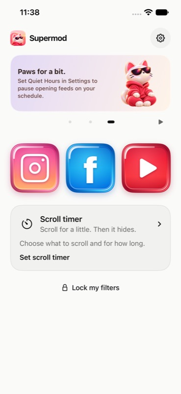
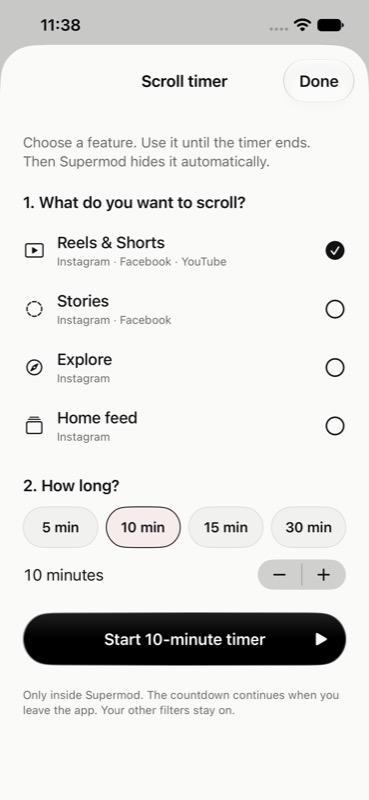
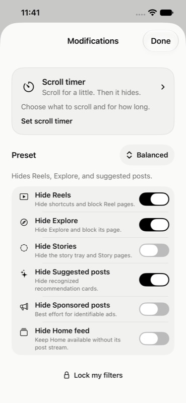

<p align="center">
  
</p>
<h1 align="center">Supermod</h1>
<p align="center"><strong>Your feeds. Your boundaries.</strong><br>Hide the distractions. Keep the parts you came for.</p>
<p align="center">
  <a href="LICENSE"></a>
  
  
  <a href="https://github.com/WarriorSushi/supermod-ios-Block-Reels-etc/actions/workflows/repository-checks.yml"></a>
</p>
<p align="center"><a href="#try-it">Try it</a> · <a href="#what-it-does">Features</a> · <a href="docs/FAQ.md">FAQ</a> · <a href="CONTRIBUTING.md">Contribute</a> · <a href="docs/ROADMAP.md">Roadmap</a></p>

Supermod is an experimental **SwiftUI + WebKit browser for iPhone**. It opens Instagram, Facebook and public YouTube pages inside the app, then applies the filters you choose. Hide Reels or Shorts, take a timed scrolling break, or keep a quieter feed.

**It works inside Supermod.** It does not modify the official apps or block them across your phone. This repository contains source code, not an App Store download, TestFlight invitation or ready-to-install IPA. You currently need a Mac and Xcode to try it.

## A look inside

<table>
  <tr>
    <td align="center"><br><strong>One home for your boundaries</strong></td>
    <td align="center"><br><strong>A break with an ending</strong></td>
    <td align="center"><br><strong>Choose what stays</strong></td>
  </tr>
</table>

Actual simulator screenshots using local test settings. No signed-in social accounts, private feeds or messages are shown.

## What it does

| Control | Instagram | Facebook | YouTube |
| --- | --- | --- | --- |
| Hide short-form video | Reels | Reels | Shorts |
| Hide Stories | Yes | Yes | — |
| Hide recognized sponsored posts | Best effort | Best effort | — |
| Hide suggested posts / Explore / Home feed | Separate controls | — | — |
| Scroll timer | Reels, Stories, Explore, Home feed | Reels, Stories | Shorts |

- **Scroll timer:** choose features and 1–60 minutes from Home. They stay available until the deadline, then hide. Edit choices without extending the timer. A small circular indicator counts down around the floating control.
- **Lock my filters:** keep your choices fixed for a chosen duration. This locks Supermod's controls, not your phone.
- **Comfort controls:** grayscale browsing, quiet hours, a launch destination, and a circular menu button that drags to either edge.
- **Feed recovery:** pull-to-refresh on supported Home feeds and clearer feedback when Instagram has more posts to load or filtering leaves a short feed.

The Instagram feed filter removes recognized suggested/sponsored entries before rendering where supported. Its fallback preserves post geometry to avoid moving neighboring posts. This depends on the site's current structure; it is not a promise to catch every ad or survive every platform update.

## Try it

1. Install a compatible Xcode on your Mac. The archived app was built with **Xcode 27.2**; the iOS deployment target is 17.0. Older Xcode versions have not been validated with its Icon Composer assets.
2. Clone and open the project:

   ```sh
   git clone https://github.com/WarriorSushi/supermod-ios-Block-Reels-etc.git
   cd supermod-ios-Block-Reels-etc
   open Supermod.xcodeproj
   ```

3. Select the **Supermod** scheme and an iPhone simulator, then Run. Swift Package Manager restores the pinned RevenueCat dependency.
4. Complete setup. Use **Explore sample preview** for a local demo or the Debug-only **Continue without paying** option to explore the app. The scheme also supports local Xcode StoreKit test purchases.

For your own iPhone, select your Apple development team and configure signing in Xcode. No signing certificates, private keys or social logins are included. The optional RevenueCat public SDK key is blank; local testing does not require one.

**[Full build, device-signing and restoration guide →](RESTORE.md)**

## Know the limits

- This is an **experimental development snapshot**, not a production-ready release. Expect website changes and device-specific bugs.
- Filtering affects the embedded websites only. No Screen Time shield, system-wide blocking or background-audio guarantee is implemented.
- Hiding Reels also blocks shared Reel pages. Some service features, including sign-in flows, may behave differently from the official apps. YouTube support is for public browsing; in-app Google sign-in is not implemented.
- Local StoreKit testing is available. Live Apple sandbox billing and production subscription flows are not fully validated. The bundled paywall is development code, not an invitation to make a real purchase.
- Third-party service permissions, media rights, privacy disclosures and distribution requirements still need review before a public binary release. Open source licensing does not provide permission from Instagram, Meta, YouTube or Apple.

See the [FAQ](docs/FAQ.md), [privacy overview](docs/PRIVACY.md) and [current roadmap](docs/ROADMAP.md).

## Under the hood

SwiftUI owns the interface and local settings. Separate persistent WebKit stores hold each service's session. Native route checks and bundled JavaScript/CSS apply the filters. StoreKit verifies subscription access; RevenueCat analytics is optional and unconfigured in this archive.

| Directory | Purpose |
| --- | --- |
| `Supermod/App` | Preferences, app lifecycle, entitlements and design system |
| `Supermod/Interior` | Home, controls, timer, settings and service screens |
| `Supermod/Social` | WebKit sessions, navigation policy and site adapters |
| `Supermod/Resources` | Filter scripts, CSS, rules, privacy manifest and bundled artwork |
| `Tests` / `UITests` | Model, StoreKit, WebKit and walkthrough coverage |
| `Design` | Artwork sources and available provenance |

[Architecture](docs/ARCHITECTURE.md) · [Development notes](docs/README.md)

## Quality and security

The 12 November 2026 development snapshot passed **54 local tests**, including filter stability, pagination recovery, timer expiry and refresh safeguards. Its sanitized archive also passed a fresh simulator build. These are historical local results; the Actions badge covers repository checks and credential scanning, **not an iOS test run**.

CI checks file integrity, public-document links and prohibited private files, and runs Gitleaks against Git history. GitHub secret scanning, push protection and private vulnerability reporting are enabled. Scanners reduce risk; they cannot prove that no sensitive data exists.

Report ordinary bugs through [Issues](https://github.com/WarriorSushi/supermod-ios-Block-Reels-etc/issues/new/choose). For credentials, private data or vulnerabilities, use [private security reporting](https://github.com/WarriorSushi/supermod-ios-Block-Reels-etc/security/advisories/new), not a public issue.

## Build it with us

Useful contributions include resilient filters, sanitized regression fixtures, accessibility improvements and device testing. Please read [CONTRIBUTING.md](CONTRIBUTING.md) before opening a pull request. Small, reproducible changes are easier to review. There is no promised release date or support SLA.

## License and independence

Project code is available under the **GNU General Public License v3.0**; see [LICENSE](LICENSE). Contributions should use the same license. Third-party SDKs and media retain their applicable terms; see [THIRD_PARTY_NOTICES.md](THIRD_PARTY_NOTICES.md).

Supermod is an independent project, not affiliated with or endorsed by Instagram, Meta, YouTube, Google or Apple. Product names identify compatibility. The software is provided without warranty under the license.
