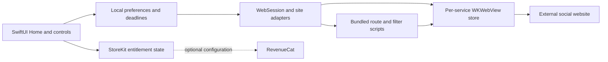

# Architecture

`Preferences` persists selected filters, timer and lock deadlines. `SupermodRoot` applies them to the active sessions and updates expiry across lifecycle transitions. A timer temporarily allows selected features until its wall-clock deadline; expiration hides those features. Filter locking prevents edits and starting new timers.

`WebSession` owns navigation, loading/recovery states, refresh and the script bridge. Site adapters define owned domains, entry points and blocked routes. Separate WebKit stores isolate Instagram, Facebook and YouTube sessions from each other. They are persistent browser stores, not a guarantee of isolation from the services' own tracking.

Instagram's document-start feed adapter filters recognized suggested/sponsored response entries before the page renders them, preserving pagination metadata. The fallback masks recognized rendered rows without collapsing their natural height or virtual-feed spacers. Bounded recovery can request the site's next page when filtering leaves a sparse feed; it avoids open editors/dialogs and stops rather than guessing indefinitely. These integrations depend on private website structures and must fail conservatively when those structures change.

The native route layer independently blocks selected destinations. Pull-to-refresh reloads supported Home pages and refuses to discard an active editor/dialog. Background tasks run only in the intended active-screen/lifecycle states.

StoreKit-verified transactions determine subscription access. Debug development access is separate and ignored in Release. RevenueCat is an optional subscription-analytics integration; the archived key is blank.

Tests cover local state, verified transaction behavior and scripts in real WKWebView fixtures. UI walkthroughs cover onboarding, timer and lock flows. Fixture results do not establish universal compatibility with the live websites.
